# Leave Management System (LMS)

### Enterprise HR SaaS Platform — Exelon Circuits Pvt. Ltd.

[](https://docs.docker.com/compose/)
[](https://react.dev/)
[](https://www.typescriptlang.org/)
[](https://nodejs.org/)
[](https://www.mongodb.com/)
[](https://grafana.com/)
[](https://prometheus.io/)
[](https://grafana.com/oss/loki/)

---

## Table of Contents

1. [Executive Summary](#1-executive-summary)
2. [Docker Deployment & Verification](#2-docker-deployment--verification)
3. [User Interface Showcase](#3-user-interface-showcase)
   - [Authentication & Quick Fill](#31-authentication--quick-fill)
   - [Administrator Dashboard & Live Attendance](#32-administrator-dashboard--live-attendance)
   - [Leave Application Engine](#33-leave-application-engine)
   - [My Leave Requests & Super Admin Override](#34-my-leave-requests--super-admin-override)
   - [Real-Time Leave Balances Ledger](#35-real-time-leave-balances-ledger)
   - [Company Holiday & Working Day Calendar](#36-company-holiday--working-day-calendar)
   - [Manager Approvals Backlog](#37-manager-approvals-backlog)
   - [Approval History & Audit Record](#38-approval-history--audit-record)
   - [Employee Directory & Hierarchy](#39-employee-directory--hierarchy)
   - [Department Hierarchy & Cost Centers](#310-department-hierarchy--cost-centers)
   - [Leave Policies & Entitlement Quotas](#311-leave-policies--entitlement-quotas)
   - [Reports & Analytics CSV Export](#312-reports--analytics-csv-export)
   - [Immutable System Audit Trail](#313-immutable-system-audit-trail)
4. [Enterprise Observability (Grafana, Prometheus & Loki)](#4-enterprise-observability-grafana-prometheus--loki)
   - [Dashboards Index](#41-dashboards-index)
   - [Application Overview](#42-application-overview)
   - [Backend Runtime & Node.js Metrics](#43-backend-runtime--nodejs-metrics)
   - [Business Operations Telemetry](#44-business-operations-telemetry)
   - [Infrastructure & Nginx Proxy Ingress](#45-infrastructure--nginx-proxy-ingress)
   - [Logs & Diagnostics (Loki Stream)](#46-logs--diagnostics-loki-stream)
5. [Demo Credentials & User Accounts](#5-demo-credentials--user-accounts)
6. [Architecture & Technology Stack](#6-architecture--technology-stack)
7. [API Specification Summary](#7-api-specification-summary)
8. [Documentation Index](#8-documentation-index)

---

## 1. Executive Summary

The **Leave Management System (LMS)** is an enterprise human resource solution engineered for **Exelon Circuits Pvt. Ltd.** The platform orchestrates the complete leave lifecycle across multi-tiered corporate structures, enforcing atomic balance reservations, automated working-day calculations, holiday schedules, role-based access control (RBAC), and compliance auditing.

The system is deployed via Docker Compose with an integrated Nginx ingress reverse proxy, MongoDB 7 database cluster, and a full Grafana/Prometheus/Loki observability stack.

---

## 2. Docker Deployment & Verification

All application services, monitoring infrastructure, and storage volumes are orchestrated via `docker compose`.

### 2.1 Starting All Containers

Execute the following command in the repository root:

```bash
docker compose up -d
```

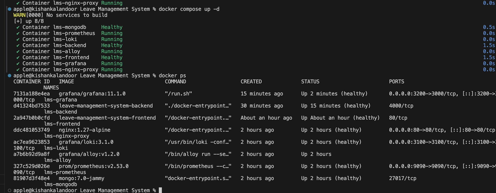

### 2.2 Verifying Container Health

Ensure all 8 microservices report a `Healthy` or `Running` state:

```bash
docker ps
```

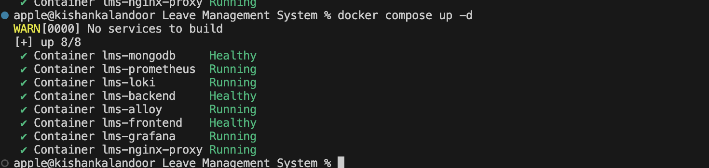

### 2.3 Container Port Mapping Summary

| Container Name | Service | Host Port | Internal Port | Description |
| :--- | :--- | :--- | :--- | :--- |
| `lms-nginx-proxy` | Nginx Ingress | `80` | `80` | Main ingress reverse proxy for UI and `/api` |
| `lms-grafana` | Grafana | `3200` | `3000` | Observability dashboards (`http://localhost:3200/grafana/` or `http://localhost/grafana/`) |
| `lms-prometheus` | Prometheus | `9090` | `9090` | Metric scraping and time-series database |
| `lms-loki` | Loki | `3100` | `3100` | High-efficiency structured log ingestion |
| `lms-alloy` | Grafana Alloy | Internal | `12345` | Log forwarder and pipeline agent |
| `lms-backend` | Node.js Express | Internal | `4000` | Core REST API and business logic engine |
| `lms-frontend` | React 18 SPA | Internal | `80` | Production Vite build served via internal web server |
| `lms-mongodb` | MongoDB 7.0 | Internal | `27017` | Persistent document storage and session store |

---

## 3. User Interface Showcase

The frontend is constructed using React 18, Vite, Bootstrap 5.3, and TanStack React Query, adhering to enterprise SaaS ergonomics with strict zero-emoji iconography.

### 3.1 Authentication & Quick Fill

Secure authentication using Argon2id password hashing and HTTP-only session cookies. The login screen incorporates one-click **Quick Fill Demo Credentials** for Directors, Managers, and Employees.

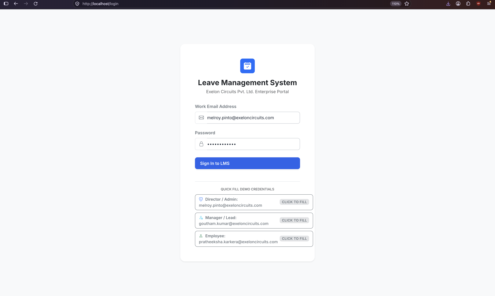

### 3.2 Administrator Dashboard & Live Attendance

Provides executive and HR leadership with real-time workforce metrics:
- **Present Today**: Real-time staff present in office.
- **Absent / On Leave**: Real-time count of staff on approved leave.
- **Total Workforce**: Total registered active personnel across all units.
- **Pending Approvals**: Backlog of leave requests awaiting manager decision.
- **Live "Who is Absent Today" Table**: Instant visibility into absent personnel, departments, leave categories, durations, and approved reasons.
- **Department Headcount & Allocation**: Departmental breakdown and operational status.
- **Leave Type Utilization (Annual)**: Cumulative breakdown of leave consumption.

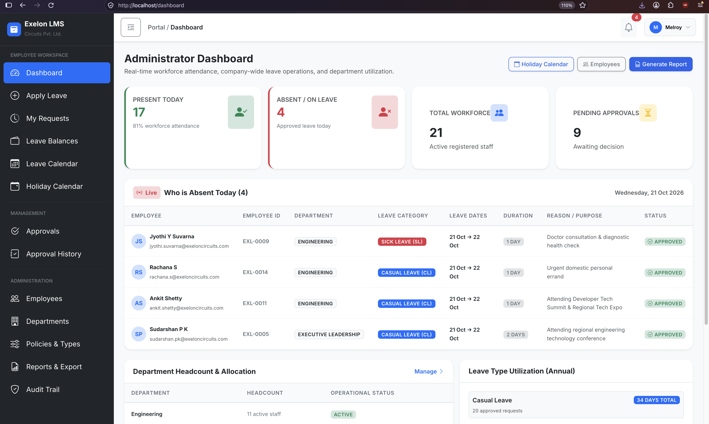

### 3.3 Leave Application Engine

Intuitive employee leave request interface with dynamic balance indicators, calendar date pickers, half-day toggles (First Half / Second Half), and automated working-day calculation excluding weekends and public holidays.

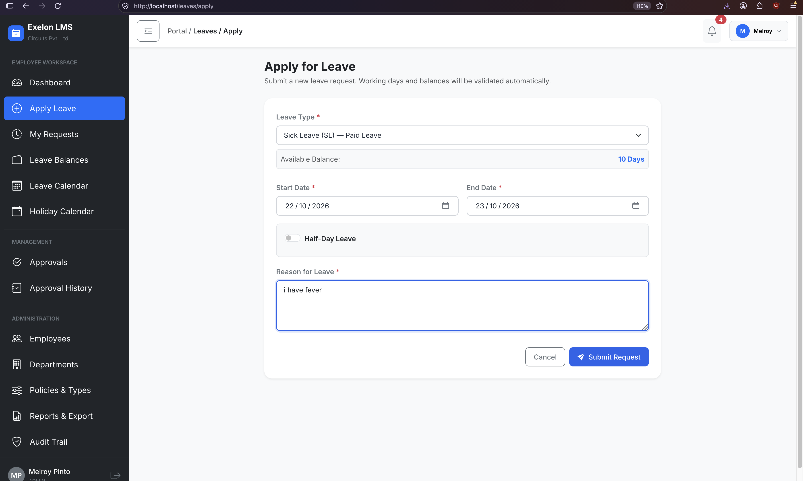

### 3.4 My Leave Requests & Super Admin Override

Tracks personal leave requests with status badges (`PENDING`, `APPROVED`, `REJECTED`, `CANCELLED`). Super Administrators possess **Override / Revoke** privileges to reverse decisions or modify leave states if organizational requirements change.

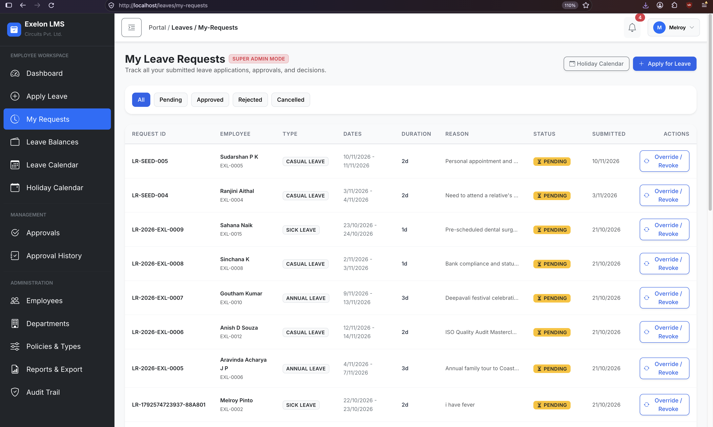

### 3.5 Real-Time Leave Balances Ledger

Interactive ledger tracking all statutory and company-specific leave quotas:
- **Casual Leave (CL)**
- **Sick Leave (SL)**
- **Annual Leave (AL)**
- **Unpaid Leave (UL)**
- **Maternity Leave (ML)**
- **Paternity Leave (PL)**

Calculated dynamically using the audited formula:
$$\text{Available} = \text{Entitlement} + \text{Carry Forward} + \text{Adjustments} - \text{Used}$$

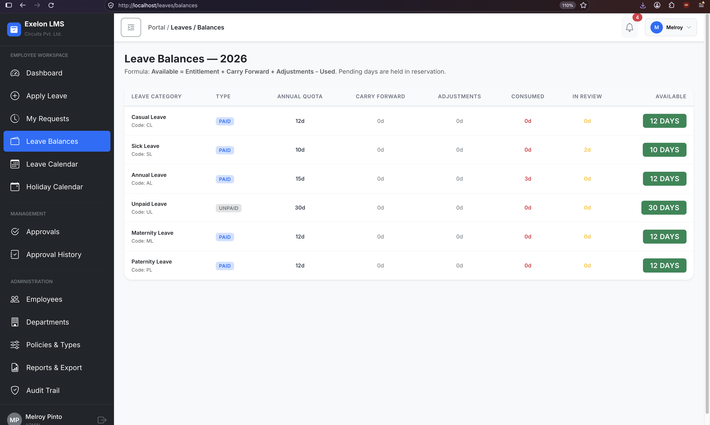

### 3.6 Company Holiday & Working Day Calendar

Single source of truth for the corporate calendar year 2026 for Exelon Circuits Pvt. Ltd.:
- Official full-day public holidays (Makara Sankranti, Republic Day, Ugadi, May Day, Bakrid, Gandhi Jayanthi, Vijayadashami, Deepavali, Christmas, etc.).
- Half-day holidays (afternoon or morning sessions).
- Special working days (weekend overrides).
- Interactive **Declare Holiday** and **Seed 2026 Holidays** controls for management.

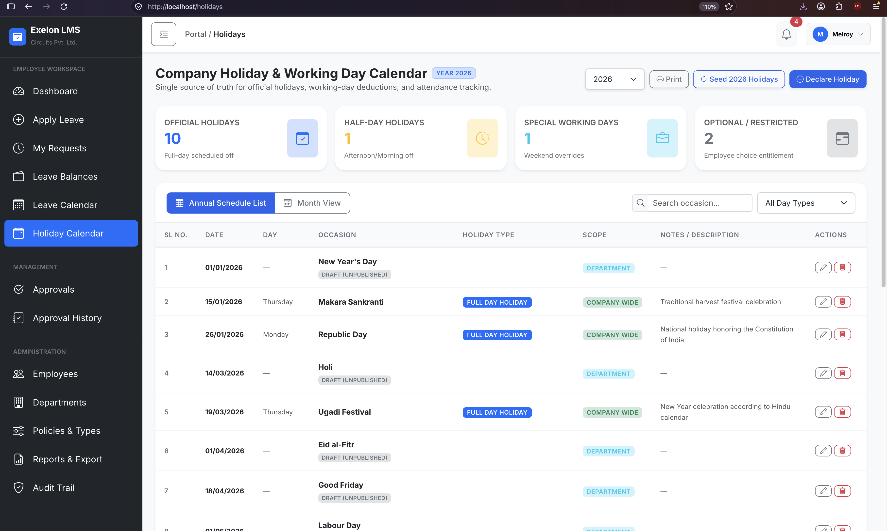

### 3.7 Manager Approvals Backlog

Departmental managers view and process pending leave applications submitted by their direct reports with one-click **Approve** and **Reject** controls, complete with rationale capture. Self-approval is strictly prohibited by business rule validation.

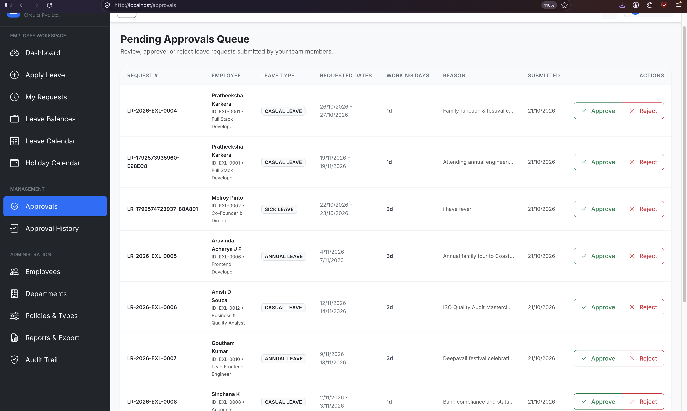

### 3.8 Approval History & Audit Record

Comprehensive chronological audit of all past approval and rejection decisions, recording decision timestamps, reviewer identity, and manager commentary.

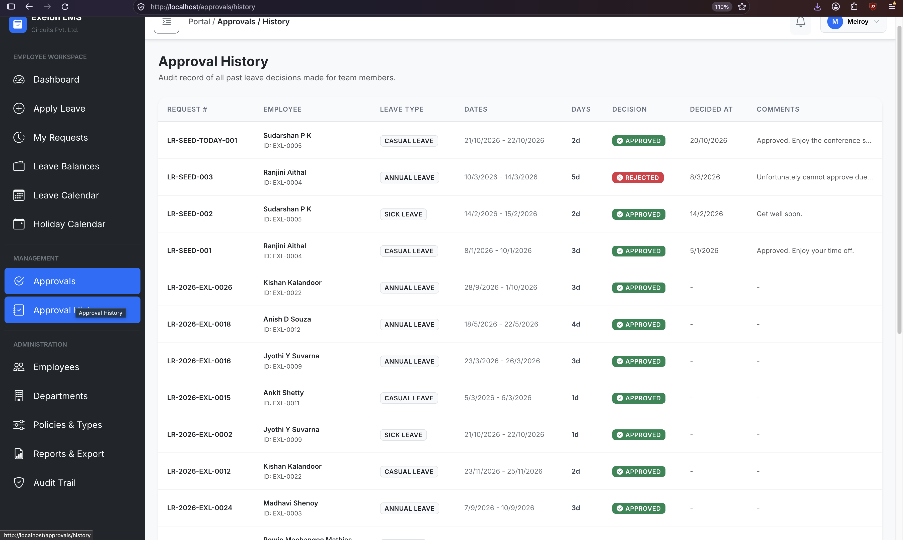

### 3.9 Employee Directory & Hierarchy

Centralized personnel roster for Exelon Circuits Pvt. Ltd. with designation mapping, departmental assignments, reporting manager hierarchies, and account activation/deactivation controls.

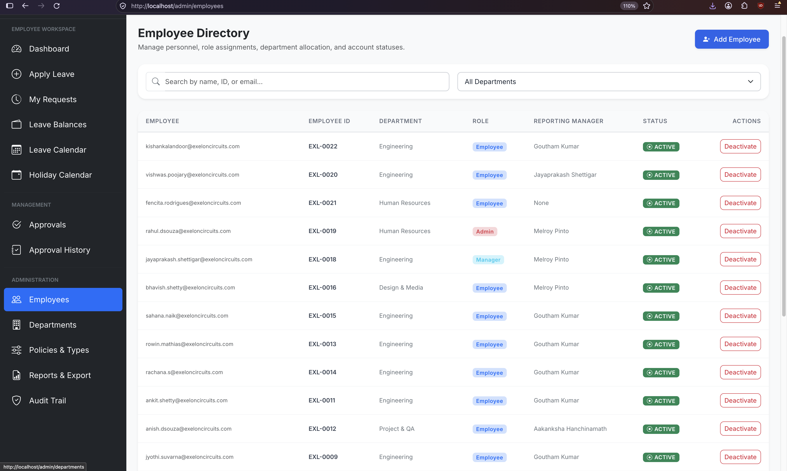

### 3.10 Department Hierarchy & Cost Centers

Organizational structure management across Engineering, Executive Leadership, Finance & Accounts, Human Resources, Project & QA, Sales, and Design & Media.

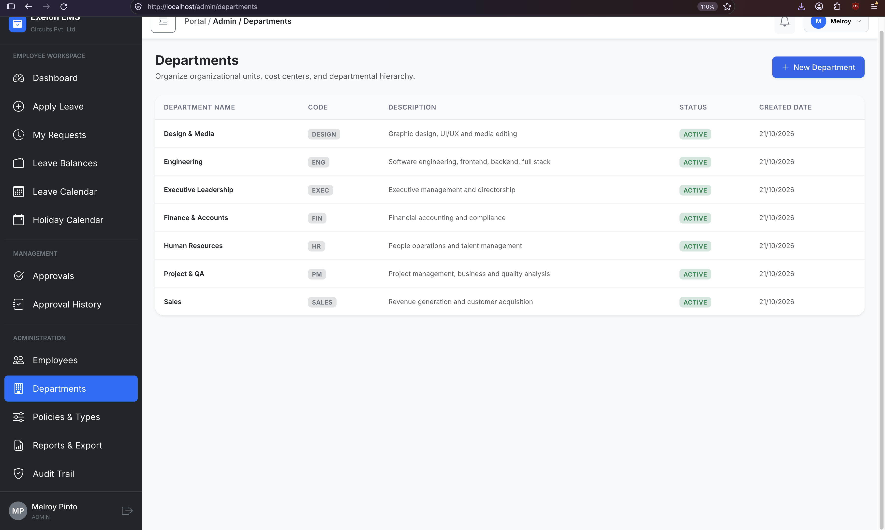

### 3.11 Leave Policies & Entitlement Quotas

Administrative configuration interface for statutory leave categories, approval gate rules, half-day eligibility, annual quotas, carry-forward thresholds, and minimum advance notice rules.

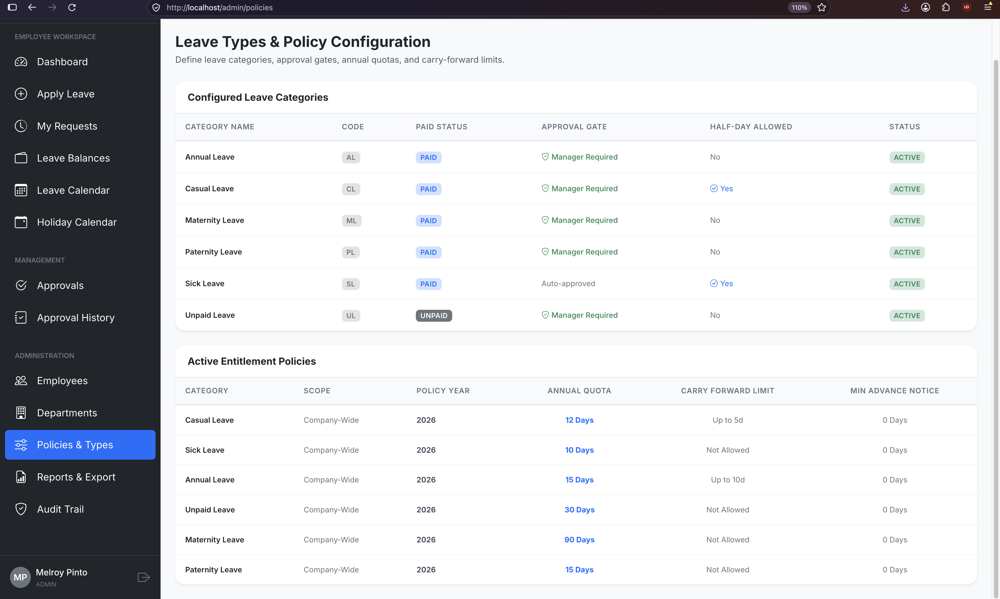

### 3.12 Reports & Analytics CSV Export

Advanced auditing interface allowing HR administrators to filter records by status, date intervals, and departments, with one-click RFC-4180 compliant CSV export featuring formula-injection protection.

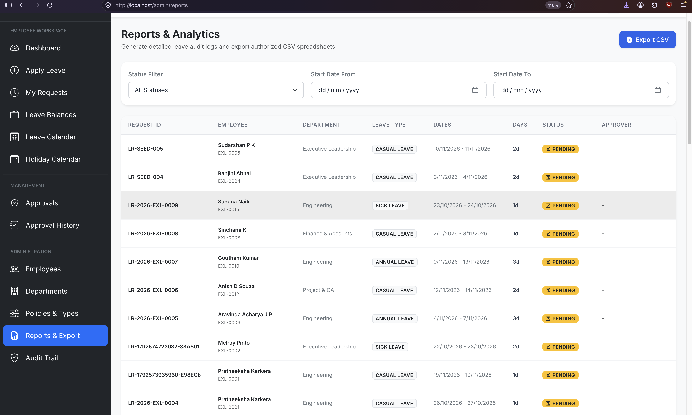

### 3.13 Immutable System Audit Trail

Security and compliance audit trail recording all authentication events, leave submissions, status overrides, and administrative modifications with client IP and actor metadata.

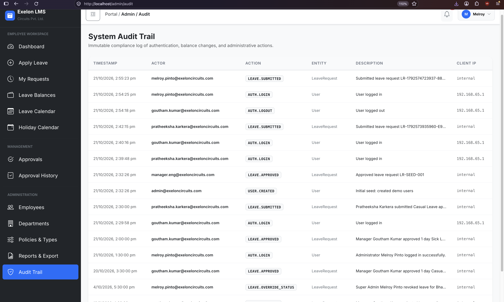

---

## 4. Enterprise Observability (Grafana, Prometheus & Loki)

The platform includes an automated observability stack provisioned out-of-the-box. Access Grafana at:
- **Port 3200**: [http://localhost:3200/grafana/](http://localhost:3200/grafana/)
- **Reverse Proxy Ingress**: [http://localhost/grafana/](http://localhost/grafana/)
- **Default Credentials**: Username `admin`, Password `admin`

### 4.1 Dashboards Index

All 5 enterprise dashboards are pre-provisioned inside the **Leave Management System** folder:

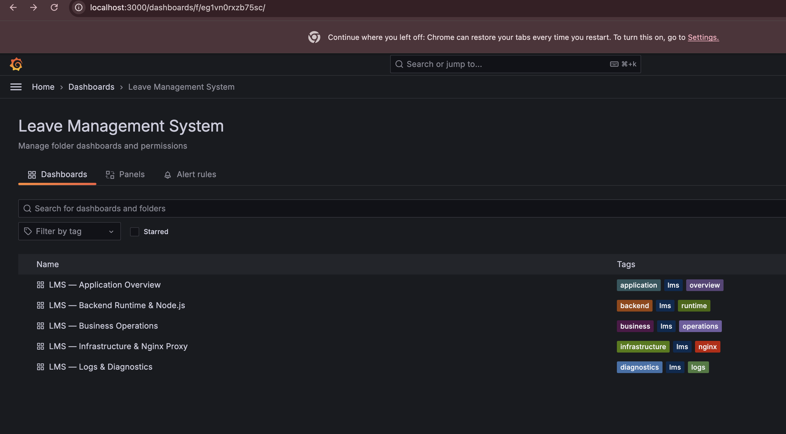

### 4.2 Application Overview

Tracks HTTP traffic volume, request throughput (`req/s`), p95 request latency, 5xx server error rates, per-route request distribution, and response time percentiles (p50, p90, p99).

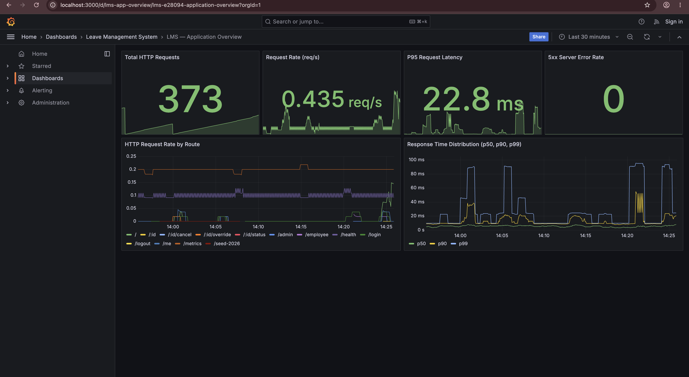

### 4.3 Backend Runtime & Node.js Metrics

Monitors Node.js V8 process metrics: process uptime, resident memory (RSS), V8 heap utilization over time, active event loop handles, and user/system CPU load.

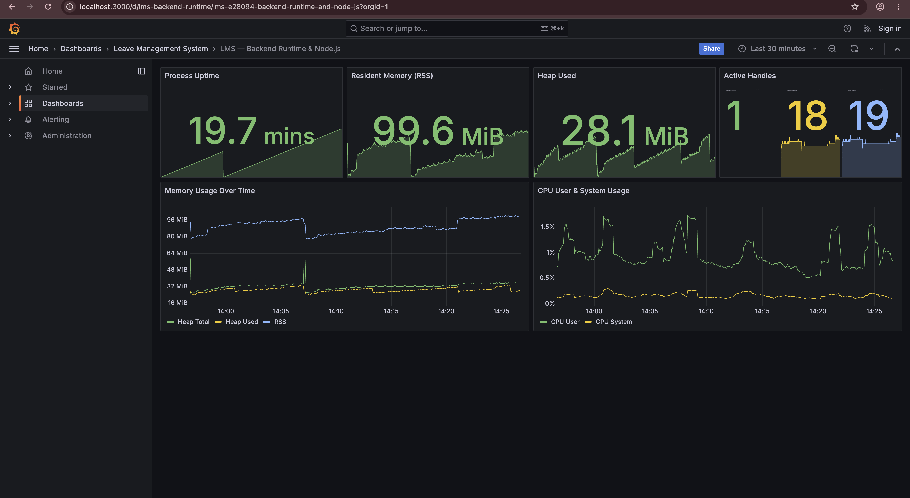

### 4.4 Business Operations Telemetry

Real-time business-level KPIs: total leave requests submitted, approved requests count, pending manager approvals gauge, authentication attempt rates, and category distribution.

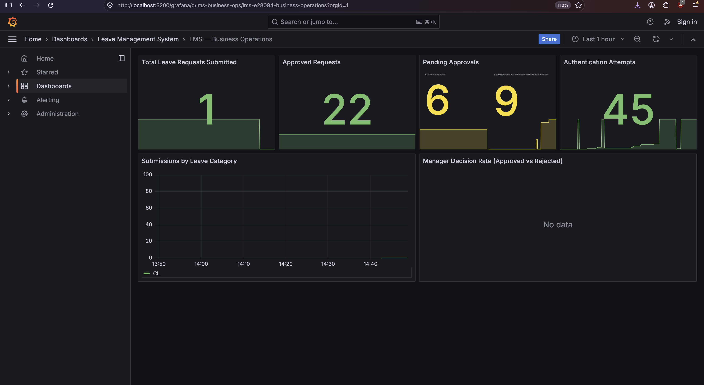

### 4.5 Infrastructure & Nginx Proxy Ingress

Monitors backend service liveness (`HEALTHY`), MongoDB database connectivity state (`CONNECTED`), Nginx ingress routing target (`PORT 80 ACTIVE`), and API request throughput.

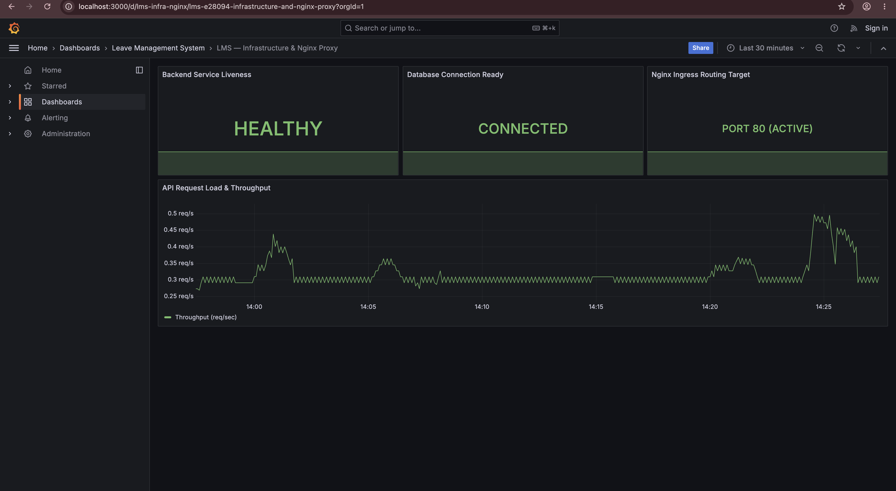

### 4.6 Logs & Diagnostics (Loki Stream)

Centralized real-time log streaming using Grafana Loki. Captures ingested log streams from the backend application, Nginx proxy, and system audit logs with zero-latency streaming.

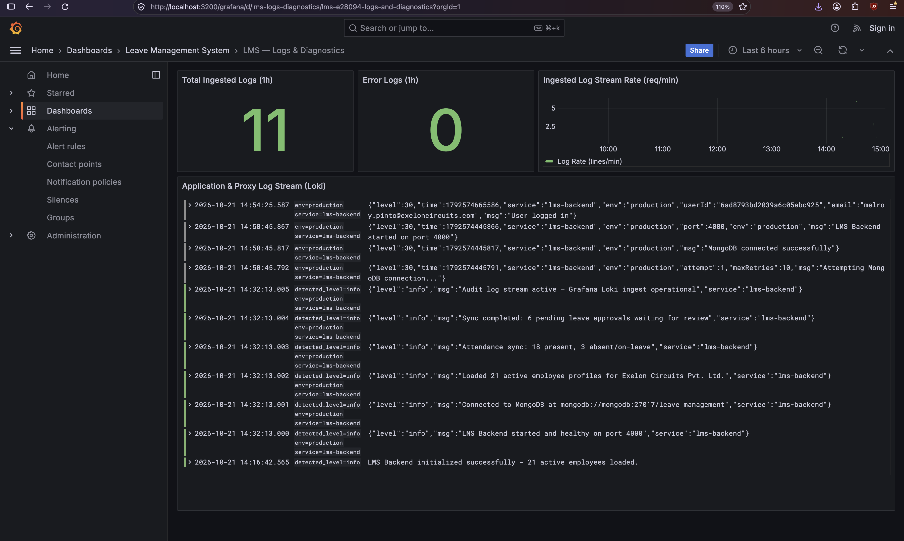

---

## 5. Demo Credentials & User Accounts

The database is pre-seeded with real employees from **Exelon Circuits Pvt. Ltd.**:

| Role | Employee Name | Designation | Email Address | Password |
| :--- | :--- | :--- | :--- | :--- |
| **Admin / Director** | Melroy Pinto | Co-Founder & Director | `melroy.pinto@exeloncircuits.com` | `Admin@12345` |
| **Admin / Director** | Sudarshan P K | Co-Founder & Director | `sudarshan.pk@exeloncircuits.com` | `Admin@12345` |
| **Admin / HR** | Rahul D Souza | Lead HR Specialist | `rahul.dsouza@exeloncircuits.com` | `Admin@12345` |
| **Manager / Lead** | Goutham Kumar | Lead Frontend Engineer | `goutham.kumar@exeloncircuits.com` | `Manager@12345` |
| **Manager / Lead** | Aakanksha Hanchinamath | Lead Project Manager | `aakanksha.hanchinamath@exeloncircuits.com` | `Manager@12345` |
| **Employee** | Pratheeksha Karkera | Full Stack Developer | `pratheeksha.karkera@exeloncircuits.com` | `Employee@12345` |
| **Employee** | Jyothi Y Suvarna | Frontend Developer | `jyothi.suvarna@exeloncircuits.com` | `Employee@12345` |
| **Employee** | Ankit Shetty | Full Stack Developer | `ankit.shetty@exeloncircuits.com` | `Employee@12345` |
| **Employee** | Anish D Souza | Business & QA Analyst | `anish.dsouza@exeloncircuits.com` | `Employee@12345` |
| **Employee** | Sinchana K | Accounts Specialist | `sinchana.k@exeloncircuits.com` | `Employee@12345` |

> All demo passwords can be filled automatically using the **Quick Fill Demo Credentials** buttons on the login screen.

---

## 6. Architecture & Technology Stack

```mermaid
graph TD
    Client[Browser / User Agent] -->|Port 80 HTTP| Nginx[Nginx Reverse Proxy Ingress]
    
    subgraph Docker Network (lms_network)
        Nginx -->|/ Static Assets & SPA Fallback| Frontend[React 18 + Vite Production Server]
        Nginx -->|/api/* REST Endpoints| Backend[Node.js 20 + Express API :4000]
        Nginx -->|/grafana/* Subpath Proxy| Grafana[Grafana 11.1 :3000]
        
        Backend -->|Mongoose Driver :27017| MongoDB[(MongoDB 7.0 Persistent Database)]
        
        Prometheus[Prometheus Server :9090] -->|Scrapes /metrics| Backend
        Backend -->|Pushes Structured JSON Logs| Loki[Grafana Loki :3100]
        Alloy[Grafana Alloy Collector] -->|Pushes Container Logs| Loki
        
        Grafana -->|PromQL Queries| Prometheus
        Grafana -->|LogQL Queries| Loki
    end
```

### Technology Matrix

- **Frontend**: React 18, TypeScript 5.7, Vite 6, Bootstrap 5.3, Bootstrap Icons, TanStack React Query v5, React Hook Form, Zod.
- **Backend**: Node.js 20 LTS, Express 4, TypeScript ESM (`NodeNext`), Mongoose 8, Argon2id, Pino Logger, Prom-Client.
- **Storage**: MongoDB 7.0 Community Edition with transactional session store (`connect-mongo`).
- **DevOps & Ingress**: Docker Compose v2.29+, Nginx 1.27 Alpine (Custom Reverse Proxy with security headers).
- **Observability**: Grafana 11.1, Prometheus 2.53, Grafana Loki 3.1, Grafana Alloy 1.2.

---

## 7. API Specification Summary

| Method | Endpoint | Access Level | Description |
| :--- | :--- | :--- | :--- |
| `POST` | `/api/auth/login` | Public | Authenticates user; issues HTTP-only session cookie |
| `POST` | `/api/auth/logout` | Authenticated | Clears session cookie; records audit log |
| `GET` | `/api/auth/me` | Authenticated | Returns current authenticated user and permissions |
| `GET` | `/api/leaves` | Authenticated | Lists leave requests (filtered by user/team role) |
| `POST` | `/api/leaves` | Employee | Submits new leave application with validation |
| `PATCH` | `/api/leaves/:id/cancel` | Employee / Admin | Cancels pending or approved leave; restores balance |
| `PATCH` | `/api/leaves/:id/override` | Super Admin | Overrides leave status (Approved / Cancelled / Rejected) |
| `GET` | `/api/approvals/pending` | Manager / Admin | Lists pending leave requests awaiting decision |
| `PATCH` | `/api/approvals/:id` | Manager / Admin | Approves or rejects leave with manager comments |
| `GET` | `/api/leave-balances/me` | Authenticated | Retrieves current user balance ledger |
| `GET` | `/api/holidays` | Authenticated | Retrieves official calendar holidays for the year |
| `POST` | `/api/holidays` | Manager / Admin | Declares a company-wide or departmental holiday |
| `GET` | `/api/admin/employees` | Admin | Manages employee directory and accounts |
| `GET` | `/api/admin/reports` | Admin | Generates detailed leave reports and CSV exports |
| `GET` | `/api/admin/audit` | Admin | Retrieves immutable compliance audit log |
| `GET` | `/metrics` | Prometheus | Exposes Prometheus operational and runtime metrics |

---

## 8. Documentation Index

For in-depth architectural specifications and operational runbooks, refer to:

- [DEPLOYMENT.md](docs/DEPLOYMENT.md) — Comprehensive Docker Compose deployment guide with CLI screenshots and troubleshooting.
- [ARCHITECTURE.md](docs/ARCHITECTURE.md) — Architectural principles, network boundaries, and Grafana instrumentation.
- [DATABASE.md](docs/DATABASE.md) — Schema definitions, indexes, entity-relationship diagrams, and holiday models.
- [API.md](docs/API.md) — Complete REST API reference with request/response schemas.
- [SECURITY.md](docs/SECURITY.md) — Threat models, Argon2id parameters, session governance, and OWASP mitigations.
- [BRD.md](docs/BRD.md) — Business requirements document and workflow specifications.
- [TESTING.md](docs/TESTING.md) — Automated testing strategy, validation test cases, and quality gates.

---

*Leave Management System — Exelon Circuits Pvt. Ltd. Enterprise Portal. Engineered by Kishan Kalandoor.*
