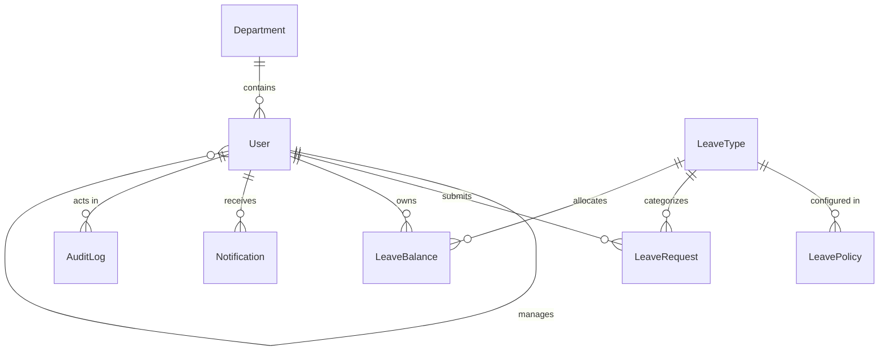

# Database Architecture & Data Modelling
## Leave Management System (LMS) — Exelon Circuits Pvt. Ltd.

---

### 1. Collections & Data Schema Overview

The database uses MongoDB 7.0 with Mongoose ODM strict schemas, validation rules, virtuals, and compound indexes.

---

### 2. Schema Details

#### `users` Collection
- `employeeId`: String, unique, indexed (e.g. `EMP-1001`)
- `firstName`, `lastName`: String
- `email`: String, unique, lowercased, indexed
- `passwordHash`: String (Argon2id)
- `role`: Enum `['employee', 'manager', 'admin']`, indexed
- `department`: ObjectId -> `departments`, indexed
- `manager`: ObjectId -> `users` (self-referential)
- `status`: Enum `['active', 'inactive']`, indexed
- `employmentStatus`: Enum `['full-time', 'part-time', 'contract', 'on-notice']`
- `joiningDate`: Date

#### `departments` Collection
- `name`: String, unique
- `code`: String, unique, uppercase (e.g. `ENG`, `QA`, `MFG`, `HR`)
- `description`: String
- `isActive`: Boolean

#### `leave_types` Collection
- `name`: String, unique (e.g. `Casual Leave`, `Sick Leave`, `Earned Leave`)
- `code`: String, unique (e.g. `CL`, `SL`, `EL`, `LWP`)
- `isPaid`: Boolean
- `requiresApproval`: Boolean
- `allowHalfDay`: Boolean
- `color`: Hex color string
- `isActive`: Boolean

#### `leave_policies` Collection
- `leaveType`: ObjectId -> `leave_types`
- `department`: ObjectId -> `departments` (nullable for company-wide default)
- `policyYear`: Number (e.g. `2026`)
- `annualEntitlement`: Number
- `carryForwardAllowed`: Boolean
- `maxCarryForwardDays`: Number
- `minAdvanceNoticeDays`: Number
- `maxConsecutiveDays`: Number

#### `leave_balances` Collection
- Compound unique index: `{ employee: 1, leaveType: 1, policyYear: 1 }`
- `employee`: ObjectId -> `users`
- `leaveType`: ObjectId -> `leave_types`
- `policyYear`: Number
- `entitlement`: Number
- `carryForward`: Number
- `adjustments`: Number
- `usedDays`: Number
- `pendingDays`: Number

**Balance Calculation Formula**:
$$\text{Available} = \max(0, \text{entitlement} + \text{carryForward} + \text{adjustments} - \text{usedDays})$$

#### `leave_requests` Collection
- `requestNumber`: String, unique, indexed (e.g. `LR-2026-0001`)
- `employee`: ObjectId -> `users`, indexed
- `leaveType`: ObjectId -> `leave_types`, indexed
- `startDate`: Date, indexed
- `endDate`: Date, indexed
- `isHalfDay`: Boolean
- `halfDayType`: Enum `['first-half', 'second-half']`
- `workingDays`: Number
- `reason`: String
- `status`: Enum `['pending', 'approved', 'rejected', 'cancelled']`, indexed
- `approver`: ObjectId -> `users`
- `approvedAt`: Date
- `approverComments`: String
- `submittedAt`: Date, indexed

#### `audit_logs` Collection
- `actor`: ObjectId -> `users`
- `actorEmail`: String
- `action`: String, indexed (e.g. `auth.login`, `leave.approved`, `user.created`)
- `entityType`: String, indexed
- `entityId`: String
- `description`: String
- `metadata`: Mixed
- `ipAddress`: String
- `createdAt`: Date, indexed

---

### 3. Data Integrity & Concurrency Guarantees

1. **Idempotency in Approvals**:
   `LeaveRequest.findOneAndUpdate({ _id: id, status: 'pending' }, ...)`
   Guarantees that a pending request can only be transitioned once. Simultaneous clicks or network retries receive `409 Already Processed`.

2. **Atomic Balance Updates**:
   `LeaveBalance.updateOne({ employee, leaveType, policyYear, pendingDays: { $gte: days } }, { $inc: { usedDays: days, pendingDays: -days } })`
   Prevents double balance deduction and race condition balance exhaustion.
